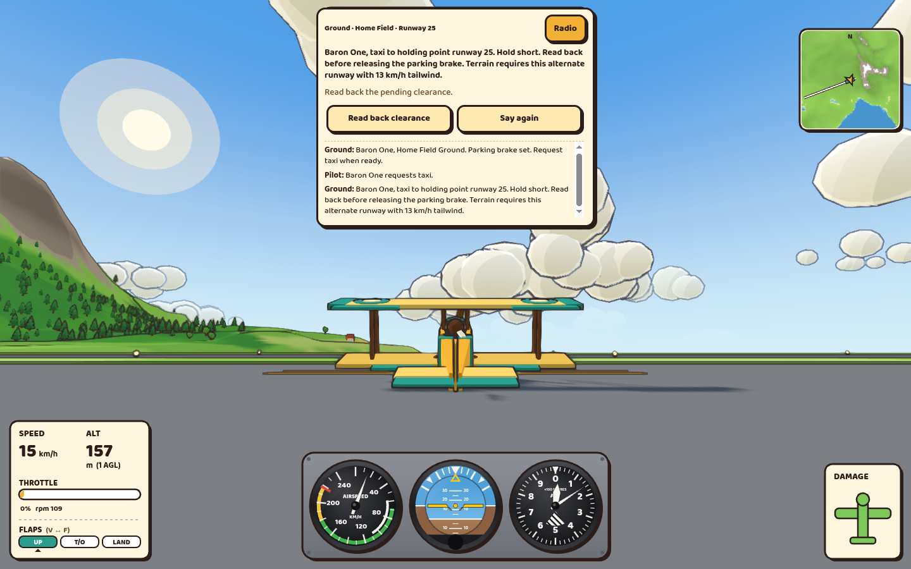

<h1 align="center">Baron</h1>

<p align="center">Take off. Explore. Land in one piece.</p>

<p align="center">
  <a href="#controls"></a>
  <a href="#guided-atc"></a>
</p>

<p align="center">
  
</p>

Fly a biplane, turboprop, or jet through a generated world. Customize your plane
in the Hangar, explore freely, or follow a cross-country route to another airfield.

## Quick start

Install Bun, then run these commands from the project folder:

```sh
cd web
bun install
bun run dev
```

Open the address shown in the terminal. Use a browser with WebGL 2 support.

1. Choose **Arcade** and **Free flight** for an easy first flight.
2. Click **FLY!** Hold **Shift** to increase throttle and steer with **Q / E**.
3. Follow the takeoff hint, then gently press **S** to lift the nose.

Choose **Cross-country** to follow the white arrows to a destination.
If the game runs slowly, select **Low** graphics.

## Controls

| Action                       | Keyboard       |
| ---------------------------- | -------------- |
| Nose down / up               | W / S or ↑ / ↓ |
| Roll left / right            | A / D or ← / → |
| Rudder / ground steering     | Q / E          |
| Increase / decrease throttle | Shift / Ctrl   |
| Extend / retract flaps       | F / V          |
| Hold brakes                  | B              |
| Change camera                | C              |
| Open / close ATC radio       | T              |
| Pause                        | Esc or P       |
| Restart flight               | R              |

On touch screens, drag on the left half to steer and use the throttle lever on
the right. Drag down to climb. Flaps, brakes, camera, and radio have on-screen
buttons. More controls, including gamepad controls, are listed in the main menu.

## Guided ATC

Enable **guided ATC** before flying to start parked instead of on the runway.
It works with Arcade, Normal, or Expert flying.

1. **Request taxi**, then **read back** the clearance to release the parking brake.
2. Follow the yellow marks to the holding point. Report ready and read back the
   runway-entry clearance before backtracking and lining up.
3. Request takeoff clearance and read it back before departing.
4. Follow the arrival guide, request landing clearance when aligned, and read it
   back. In free flight, first request an arrival at the airfield named in the radio.
5. After landing, brake, vacate the runway, and stop. Select **Finish flight**.

Use gentle throttle while taxiing. **Say again** repeats an instruction;
**Go around** cancels landing clearance and gives you a new approach.
Radio calls are text-only for now.
